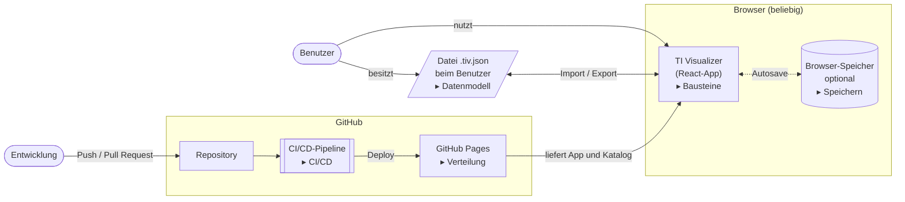
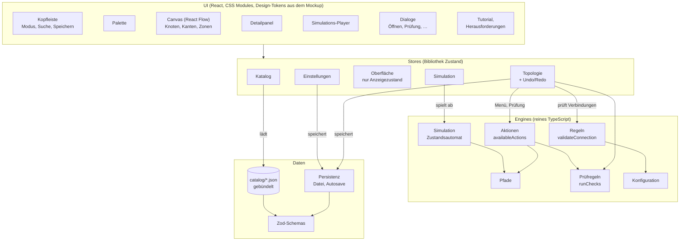
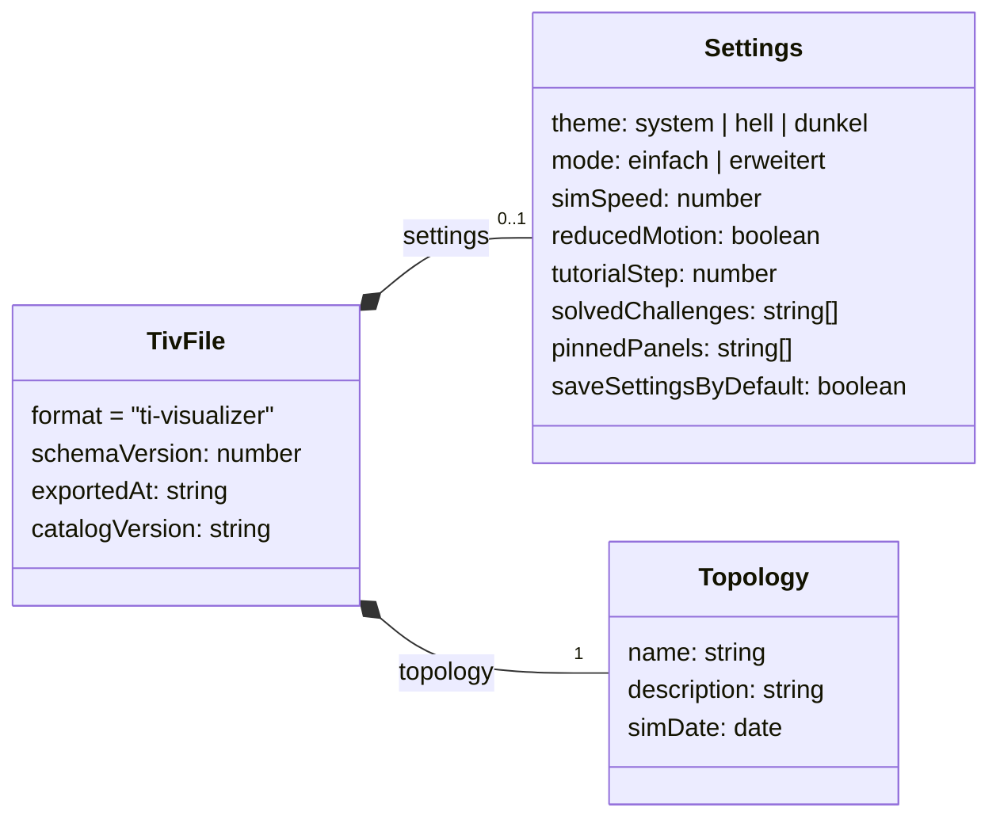
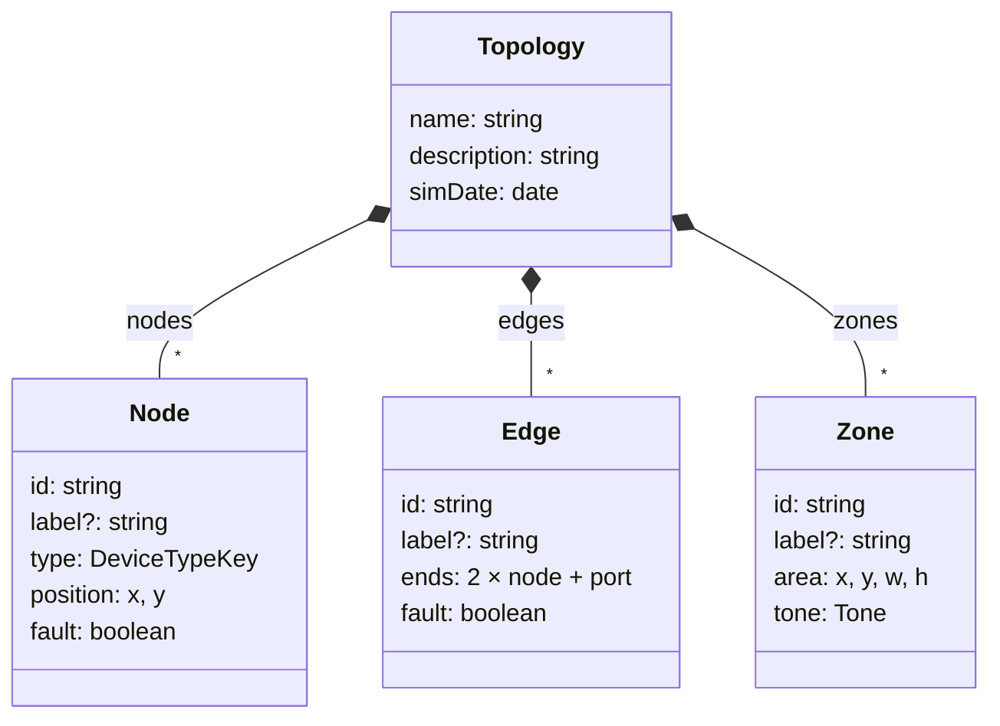
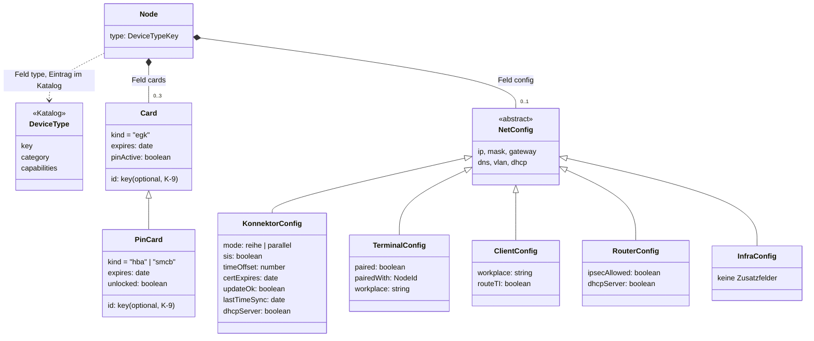
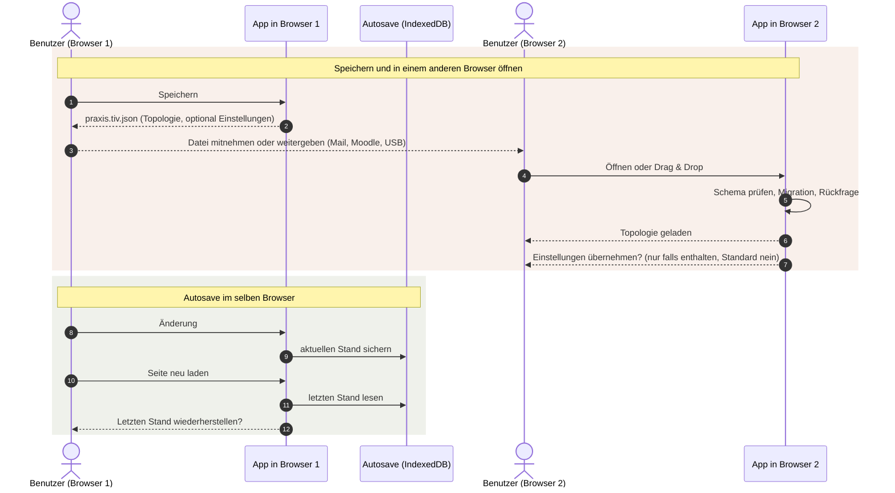
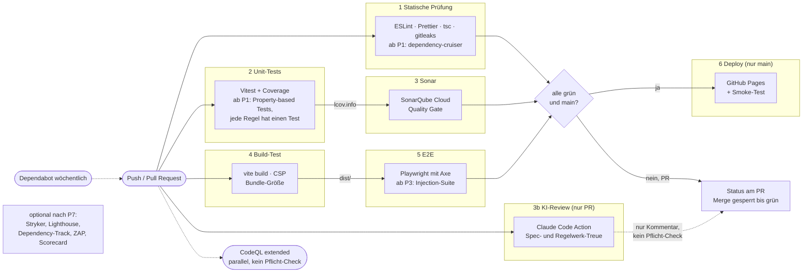
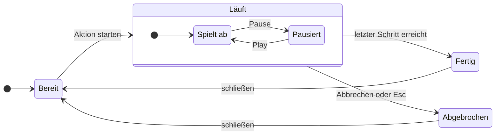
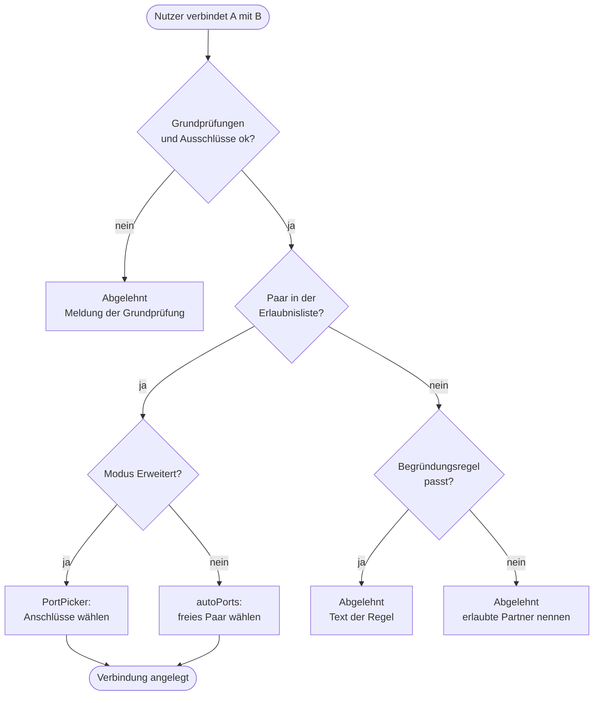
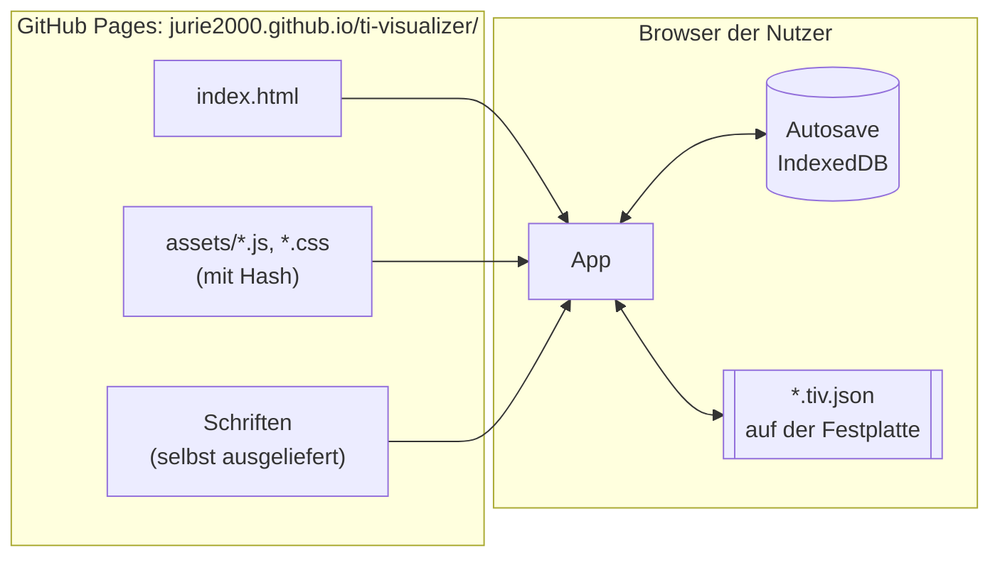

# Architektur 001: TI Visualizer

**Stand:** 2026-11-04 · **Bezug:** [plan.md](./plan.md) (D1 bis D36),
[spec.md](./spec.md), [regelwerk.md](./regelwerk.md)

Die Diagramme sind in [Mermaid](https://mermaid.js.org/) geschrieben.
GitHub zeigt sie direkt als Grafik an. Lokal geht das zum Beispiel mit der
Mermaid-Vorschau in VS Code oder IntelliJ.

Inhalt: 1 Systemkontext · 2 Bausteine · 3 Datenmodell · 4 Speichern
und Öffnen · 5 CI/CD-Pipeline · 6 Simulation · 7 Verbinden
prüfen · 8 Verteilung

## 1. Systemkontext

Der Systemkontext zeigt, wer mit dem TI Visualizer arbeitet und mit
welchen Systemen er verbunden ist. Die App läuft vollständig im Browser,
einen eigenen Server gibt es nicht (D1). Es gibt eine Rolle, den Benutzer.
Seine Topologien gehören ihm als Datei und hängen nicht vom Browser ab
(D3, D34).

Bausteine mit „▸“ sind in einem eigenen Diagramm genauer dargestellt.



**Genauer dargestellt:**
[TI Visualizer → 2 Bausteine](#2-bausteine) ·
[Datei → 3 Datenmodell](#3-datenmodell) ·
[Browser-Speicher → 4 Speichern und Öffnen](#4-speichern-und-öffnen) ·
[CI/CD-Pipeline → 5 CI/CD-Pipeline](#5-cicd-pipeline) (dort auch
SonarQube Cloud, KI-Review und Sicherheitsprüfungen) ·
[GitHub Pages → 8 Verteilung](#8-verteilung)

Die Klick-Verweise im Diagramm funktionieren in Werkzeugen, die Mermaid
mit Interaktion anzeigen (z. B. Mermaid Live Editor, Obsidian). GitHub
zeigt Mermaid im gesicherten Modus an, dort sind Klicks im Diagramm
gesperrt. Dafür gibt es die Linkliste oben.

## 2. Bausteine

Schichten der App. Pfeile zeigen, wer wen aufruft. Engines sind reines
TypeScript ohne React und ohne Browser-Speicher (vollständig testbar).



Der Store „Oberfläche“ hat absichtlich keine Verbindung nach unten. Er hält
nur, was gerade angezeigt wird (offenes Panel, ausgewähltes Gerät), und
wird weder geprüft noch gespeichert.

**Genauer dargestellt:** [Simulation → 6 Simulation](#6-simulation) ·
[Regeln → 7 Verbinden prüfen](#7-verbinden-prüfen) ·
[Persistenz → 4 Speichern und Öffnen](#4-speichern-und-öffnen) ·
[Datenformat → 3 Datenmodell](#3-datenmodell)

## 3. Datenmodell

Aufbau des Dateiformats `.tiv.json` (D23) und der Topologie (D35), in
drei Teilen. Eine Datei enthält immer eine Topologie und optional die
Einstellungen. Gemeinsame Felder stehen in Basistypen, Varianten werden über
ein Feld wie `kind` unterschieden. Welche Geräte Karten oder
Einstellungen haben dürfen, legt der Katalog über Fähigkeiten fest.

Zeichen: Dreieck = „erweitert“ (übernimmt alle Felder des Basistyps),
Raute = „besteht aus“ (mit Anzahl), «abstract» = kommt nie allein vor.

### 3.1 Datei



Eine Datei enthält immer genau eine `topology` und höchstens einmal
`settings` (D23). Einstellungen werden nur mitgespeichert, wenn der
Benutzer es beim Speichern wählt, und beim Öffnen nur nach Rückfrage
übernommen. Eine Datei nur mit Einstellungen gibt es nicht. Den Aufbau
von `topology` zeigen 3.2 und 3.3.

**Beispiel:** `praxis.tiv.json`, mit mitgespeicherten Einstellungen. Ohne
Häkchen fehlt der Block `settings`. Der Inhalt von `topology` steht
ausführlich in 3.2.

```json
{
  "format": "ti-visualizer",
  "schemaVersion": 1,
  "exportedAt": "2026-11-04T10:00:00Z",
  "catalogVersion": "1",
  "settings": {
    "theme": "dunkel",
    "mode": "erweitert",
    "simSpeed": 1.5,
    "reducedMotion": false,
    "tutorialStep": 4,
    "solvedChallenges": ["kein-rezept-am-empfang"],
    "pinnedPanels": ["palette"],
    "saveSettingsByDefault": false
  },
  "topology": { "name": "Kleine Arztpraxis", "description": "…", "simDate": "2026-11-01", "nodes": [], "edges": [], "zones": [] }
}
```

### 3.2 Topologie



`id` und `label` stammen aus dem gemeinsamen Basistyp `Element`, `fault`
aus `Disruptable`. Im Diagramm stehen sie zur Übersicht direkt bei den
Bausteinen. Kanten haben genau zwei gleichwertige Enden (D15). Jedes Ende
nennt einen Knoten und dessen Anschluss.

**Beispiel:** der Inhalt von `topology` aus `praxis.tiv.json`. Ein PVS und
ein Kartenterminal hängen am Switch, der Switch am Konnektor. Eine Zone
fasst das Praxisnetz zusammen. Die Zusatzfelder `cards` und `config` der
Knoten stehen in 3.3.

```json
{
  "name": "Kleine Arztpraxis",
  "description": "PVS und Kartenterminal am Konnektor",
  "simDate": "2026-11-01",
  "nodes": [
    { "id": "pvs1", "type": "pvs", "label": "Sprechzimmer", "position": { "x": 80,  "y": 200 }, "fault": false },
    { "id": "kt1",  "type": "kt",  "label": "Empfang",      "position": { "x": 80,  "y": 60 },  "fault": false },
    { "id": "sw1",  "type": "switch",                       "position": { "x": 280, "y": 130 }, "fault": false },
    { "id": "kon1", "type": "kon",                          "position": { "x": 480, "y": 130 }, "fault": false }
  ],
  "edges": [
    { "id": "e1", "ends": [ { "node": "pvs1", "port": "eth0" }, { "node": "sw1",  "port": "p1"  } ], "fault": false },
    { "id": "e2", "ends": [ { "node": "kt1",  "port": "lan0" }, { "node": "sw1",  "port": "p2"  } ], "fault": false },
    { "id": "e3", "ends": [ { "node": "sw1",  "port": "p8"   }, { "node": "kon1", "port": "lan" } ], "fault": true,
      "label": "Kabel abgezogen" }
  ],
  "zones": [
    { "id": "z1", "label": "Praxisnetz", "area": { "x": 40, "y": 20, "w": 560, "h": 260 }, "tone": "sage" }
  ]
}
```

| Im Diagramm | Im Beispiel |
|---|---|
| Node `position: x, y` | `"position": { "x": 80, "y": 200 }` |
| Edge `ends: 2 × node + port` | `"ends": [ { "node": "pvs1", "port": "eth0" }, { "node": "sw1", "port": "p1" } ]` |
| Zone `area: x, y, w, h` | `"area": { "x": 40, "y": 20, "w": 560, "h": 260 }` |
| `fault` | Kante `e3` ist als unterbrochen markiert |
| `label?` | optional, der Switch hat keins |

### 3.3 Karten und Einstellungen am Gerät



`cards` und `config` sind Teile des Knotens, keine eigenen Geräte auf der
Fläche. In der Datei stehen sie als verschachtelte Objekte im Knoten.
Eigene Kästen haben sie im Diagramm nur, weil es von ihnen Varianten gibt.
`DeviceType` steht nicht in der Datei, sondern im Katalog der App. Der
Knoten trägt nur den Schlüssel (`"type": "kt"`).

Welche Felder ein Knoten haben darf, hängt von seinem Gerätetyp ab
(Beispiele):

| Gerätetyp (`type`) | Fähigkeiten im Katalog | erlaubte Zusatzfelder im Knoten |
|---|---|---|
| `kt` (Kartenterminal) | `cardSlots`, `netConfig:terminal` | `cards`, `config` als TerminalConfig |
| `kon` (Konnektor) | `netConfig:konnektor` | `config` als KonnektorConfig |
| `pvs` (Praxisverwaltungssystem) | `netConfig:client` | `config` als ClientConfig |
| `router` | `netConfig:router` | `config` als RouterConfig |
| `switch`, `ap`, `fw` (Switch, Access Point, Firewall) | `netConfig:infra` | `config` als InfraConfig, nur die Grundfelder aus NetConfig |
| `hskon`, `gateway` | `netConfig:konnektor` | `config` als KonnektorConfig |
| `erp` (E-Rezept-Fachdienst) | keine | keine Zusatzfelder, nur `id`, `label`, `type`, `position`, `fault` |

**Beispiel:** dieselben Knoten wie in 3.2, jetzt mit ihren Zusatzfeldern
(im Modus Erweitert).

```json
[
  {
    "id": "kt1", "type": "kt", "label": "Empfang", "position": { "x": 80, "y": 60 }, "fault": false,
    "cards": [
      { "kind": "smcb", "expires": "2028-06-30", "unlocked": true },
      { "kind": "hba",  "expires": "2027-03-31", "unlocked": false },
      { "kind": "egk",  "expires": "2029-12-31", "pinActive": true }
    ],
    "config": {
      "ip": "192.168.10.13", "mask": "255.255.255.0", "gateway": "192.168.10.2",
      "dns": "192.168.10.2", "vlan": "TI", "dhcp": false,
      "paired": true, "pairedWith": "kon1", "workplace": "AP-Empfang"
    }
  },
  {
    "id": "pvs1", "type": "pvs", "label": "Sprechzimmer", "position": { "x": 80, "y": 200 }, "fault": false,
    "config": {
      "ip": "192.168.10.20", "mask": "255.255.255.0", "gateway": "192.168.10.2",
      "dns": "192.168.10.2", "vlan": "TI", "dhcp": false,
      "workplace": "AP-Empfang", "routeTI": true
    }
  },
  {
    "id": "kon1", "type": "kon", "position": { "x": 480, "y": 130 }, "fault": false,
    "config": {
      "ip": "192.168.10.2", "mask": "255.255.255.0", "gateway": "", "dns": "", "vlan": "TI", "dhcp": false,
      "mode": "reihe", "sis": false, "timeOffset": 0, "certExpires": "2029-03-31", "updateOk": true,
      "lastTimeSync": "2026-11-01", "dhcpServer": false
    }
  },
  {
    "id": "sw1", "type": "switch", "position": { "x": 280, "y": 130 }, "fault": false,
    "config": {
      "ip": "192.168.10.3", "mask": "255.255.255.0", "gateway": "192.168.10.2",
      "dns": "192.168.10.2", "vlan": "TI", "dhcp": false
    }
  }
]
```

| Knoten | Was das Beispiel zeigt |
|---|---|
| `kt1` | `cards` mit zwei `PinCard` (SMC-B freigeschaltet, HBA nicht freigeschaltet) und einer `Card` (eGK ohne `unlocked`). `config` als TerminalConfig (`paired`, `workplace`) |
| `pvs1` | keine `cards`, weil ein PVS die Fähigkeit `cardSlots` nicht hat. `config` als ClientConfig (`workplace`, `routeTI`) |
| `kon1` | `config` als KonnektorConfig (`mode`, `sis`, `timeOffset`, `certExpires`, `updateOk`) |
| `sw1` | `config` als InfraConfig: nur IP, Maske, Gateway, DNS, VLAN und DHCP, keine Karten |

Die Sicherheitsprüfung würde hier einen Befund melden: Der HBA in `kt1`
ist nicht freigeschaltet (Regelwerk P-22).

**Regeln, die das Schema (Zod) prüft:**

| Was | Wie |
|---|---|
| Datei | `topology` muss vorhanden sein, sonst wird die Datei abgelehnt. `settings` ist optional |
| Kartenart | `kind` entscheidet zwischen `Card` (eGK) und `PinCard` (HBA, SMC-B). Nur `PinCard` hat `unlocked` (Regelwerk K-4) |
| Karten am Gerät | `cards` nur, wenn der Gerätetyp die Fähigkeit `cardSlots` hat |
| Einstellungen am Gerät | `config` nur, wenn der Gerätetyp eine Fähigkeit `netConfig:konnektor`, `netConfig:terminal`, `netConfig:client`, `netConfig:router` oder `netConfig:infra` hat. Die Fähigkeit bestimmt die Variante |
| Kanten | genau zwei Enden, beide zeigen auf vorhandene Knoten und Anschlüsse |

## 4. Speichern und Öffnen

Der einzige Weg zu einem anderen Browser oder Benutzer ist die Datei
(D24). Sie enthält immer die Topologie, die Einstellungen nur auf Wunsch
(D23). Der
Autosave sichert nur im eigenen Browser (D34).



## 5. CI/CD-Pipeline

Stufen aus [plan.md](./plan.md#cicd-pipeline-und-deployment-d8-d26-d27).
Deploy nur auf `main` und nur, wenn alles grün ist.



## 6. Simulation

Zustandsautomat des Simulations-Players (FR-9, FR-10).



| Zustand | Name im Code | Was der Benutzer sieht | Bedienung |
|---|---|---|---|
| Bereit | `idle` | kein Player, Kontextmenü verfügbar | Aktion im Kontextmenü starten |
| Spielt ab | `running` | Paket wandert, Erklärtext je Schritt | Leertaste pausiert, Tempo-Regler |
| Pausiert | `paused` | Schritt bleibt stehen | Leertaste spielt weiter, Pfeiltasten gehen einen Schritt vor oder zurück |
| Fertig | `done` | Zusammenfassung des Ablaufs | schließen |
| Abgebrochen | `cancelled` | Hinweis, bei welchem Schritt abgebrochen wurde | schließen |

Abbrechen (Knopf oder Esc) geht aus „Spielt ab“ und aus „Pausiert“.

## 7. Verbinden prüfen

Prüflogik aus [Regelwerk 4.0](./regelwerk.md#40-prüflogik-entschieden-2026-11-03).



## 8. Verteilung

Was wo liegt, nachdem die Pipeline gelaufen ist.


