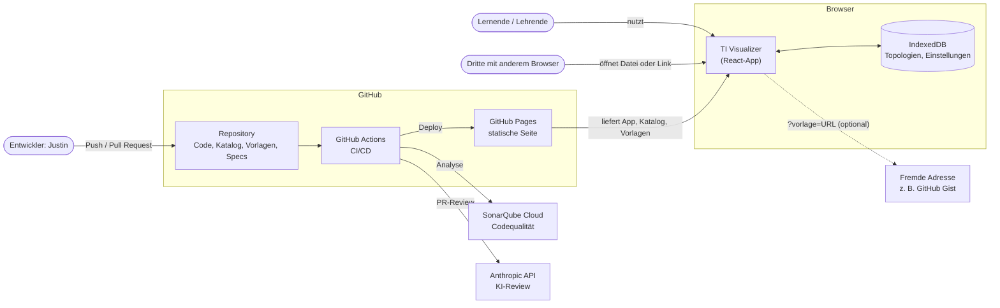
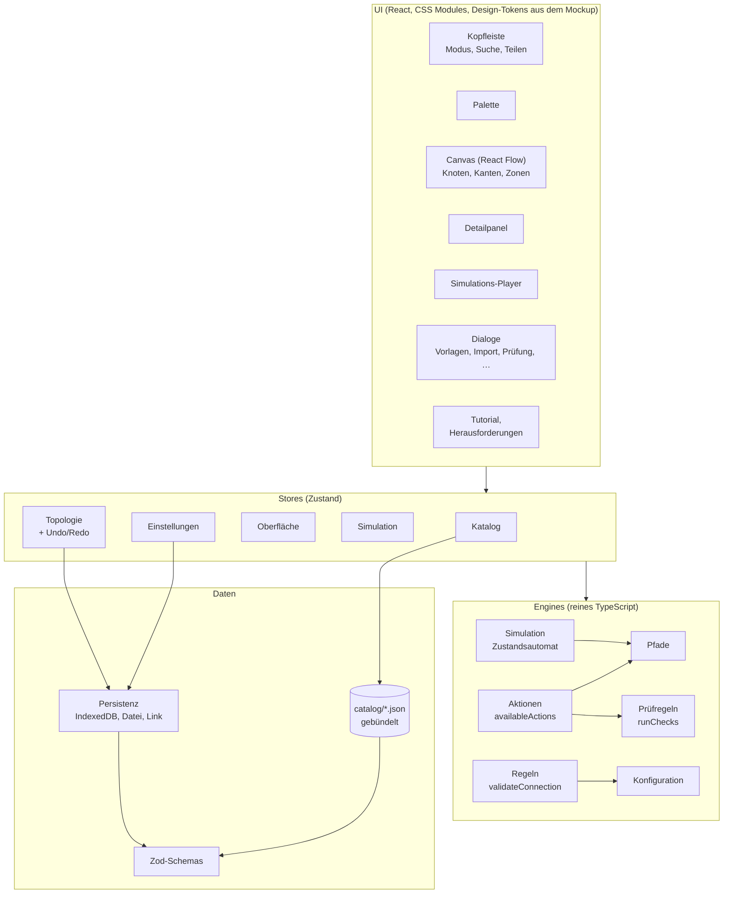
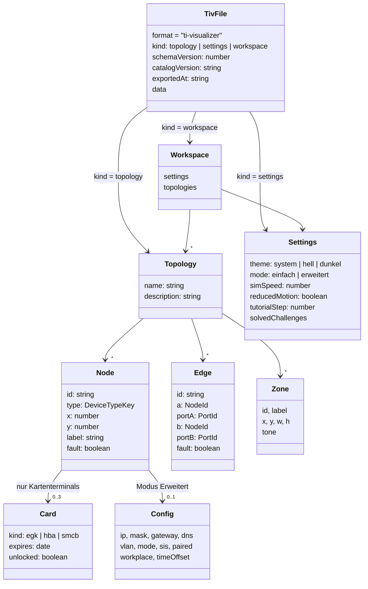
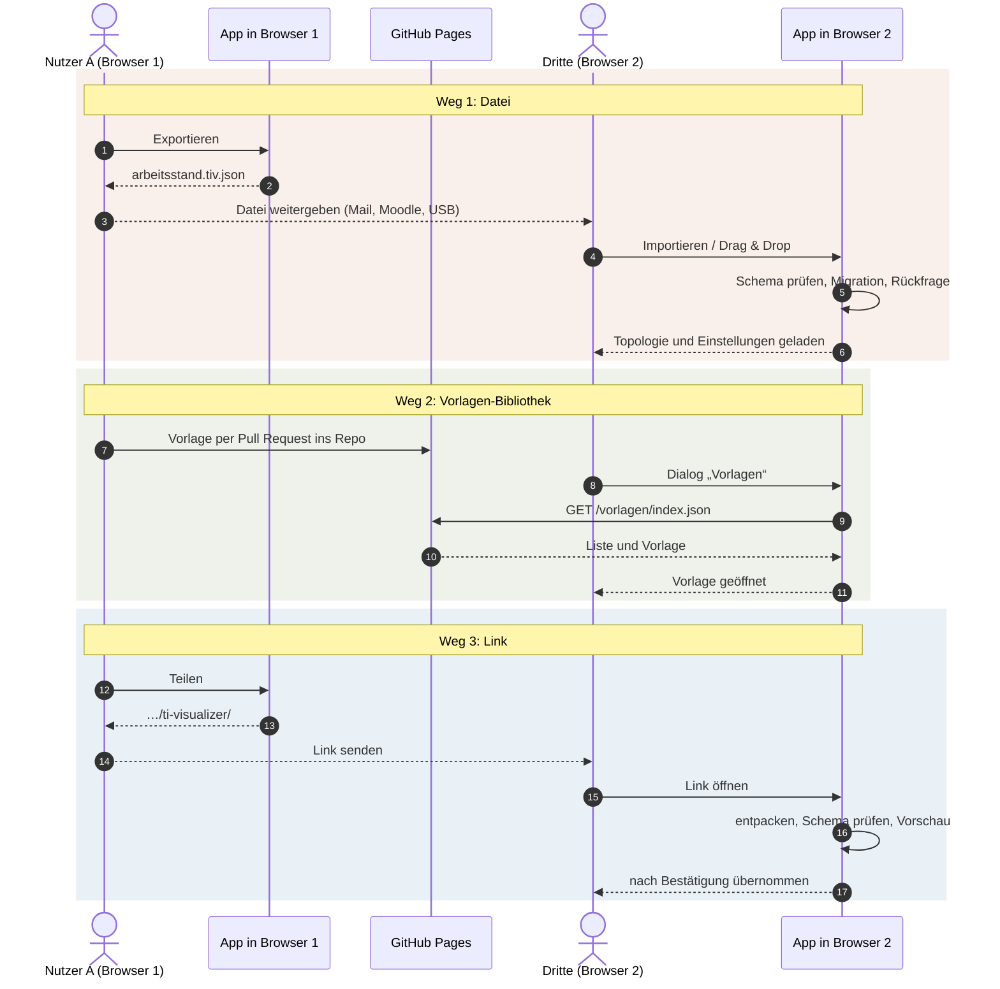
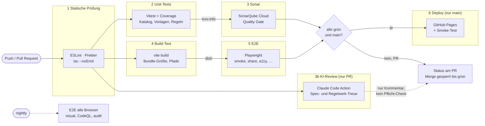
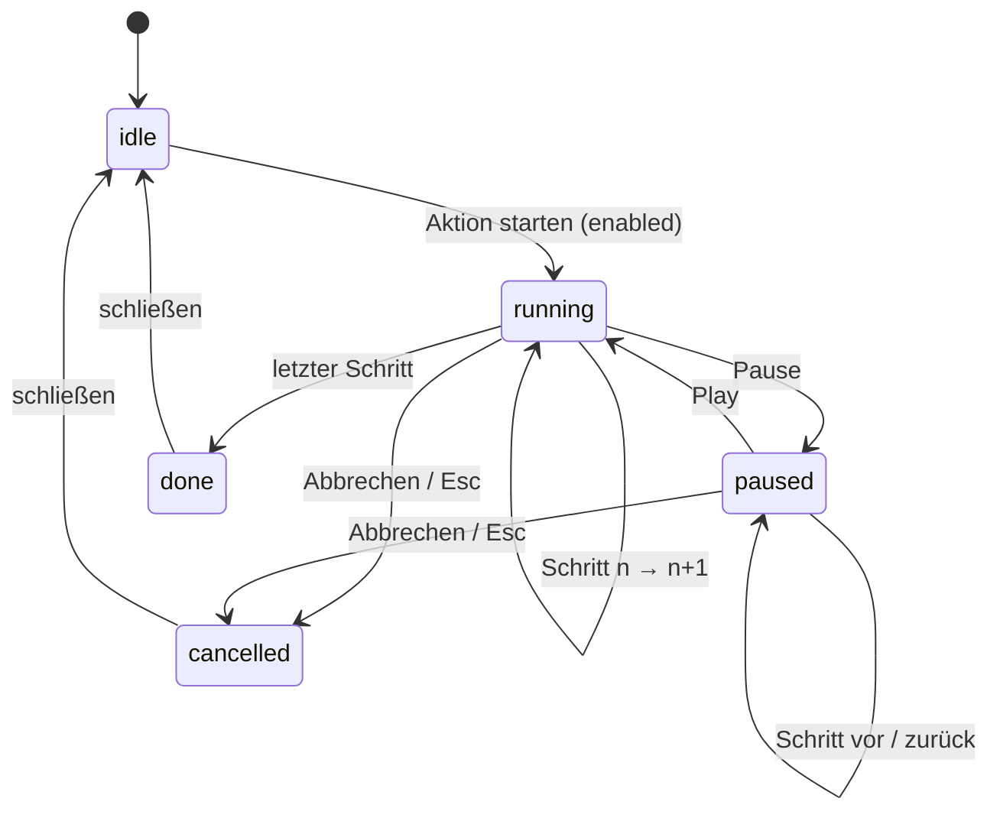
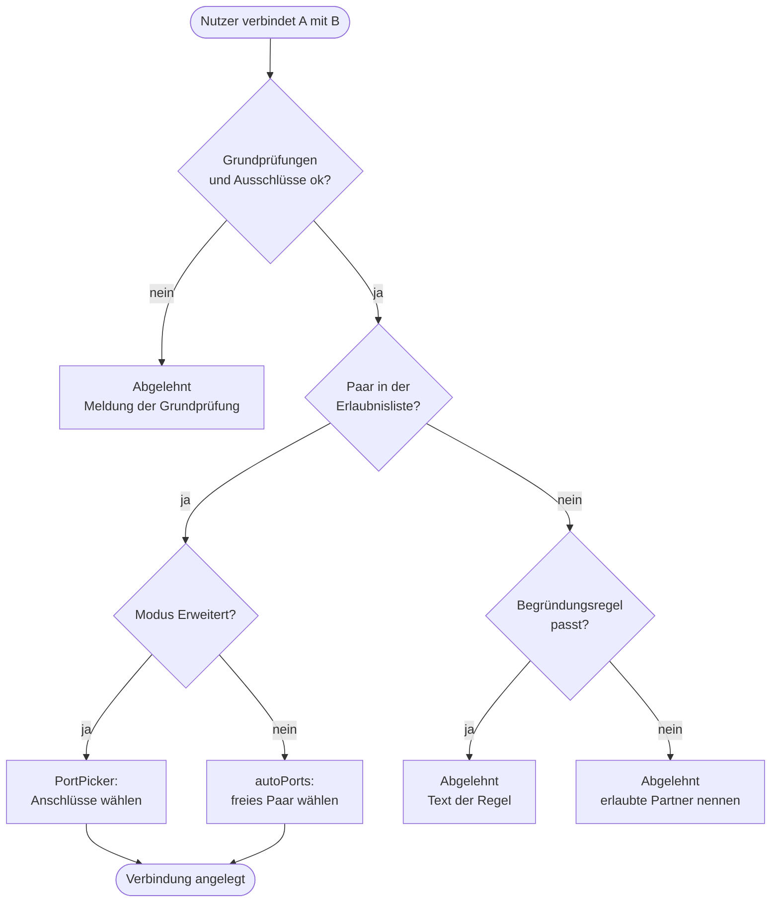
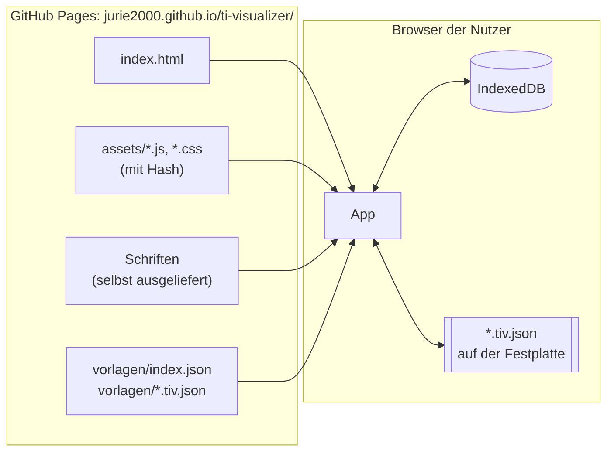

# Architektur 001: TI Visualizer

**Stand:** 2026-11-04 · **Bezug:** [plan.md](./plan.md) (D1–D28),
[spec.md](./spec.md), [regelwerk.md](./regelwerk.md)

Die Diagramme sind in [Mermaid](https://mermaid.js.org/) geschrieben.
GitHub zeigt sie direkt als Grafik an; lokal geht das z. B. mit der
Mermaid-Vorschau in VS Code oder IntelliJ.

Inhalt: 1 Systemkontext · 2 Bausteine · 3 Datenmodell · 4 Teilen
zwischen Browsern · 5 CI/CD-Pipeline · 6 Simulation · 7 Verbinden
prüfen · 8 Verteilung

## 1. Systemkontext

Wer und was mit der App zu tun hat. Es gibt keinen eigenen Server; alles
läuft im Browser (D1).

## 2. Bausteine

Schichten der App. Pfeile zeigen, wer wen aufruft. Engines sind reines
TypeScript ohne React und ohne Browser-Speicher (vollständig testbar).

## 3. Datenmodell

Kern des Dateiformats `.tiv.json` (D23) und der Topologie.

## 4. Teilen zwischen Browsern

Drei Wege (D24): Datei, Vorlagen-Bibliothek, Link. Jeder Import läuft
durch dieselbe Prüfung.

## 5. CI/CD-Pipeline

Stufen aus [plan.md](./plan.md#cicd-pipeline-und-deployment-d8-d26-d27).
Deploy nur auf `main` und nur, wenn alles grün ist.

## 6. Simulation

Zustandsautomat des Players (FR-9, FR-10).

## 7. Verbinden prüfen

Prüflogik aus [Regelwerk 4.0](./regelwerk.md#40-prüflogik-entschieden-2026-11-03).

## 8. Verteilung

Was wo liegt, nachdem die Pipeline gelaufen ist.

