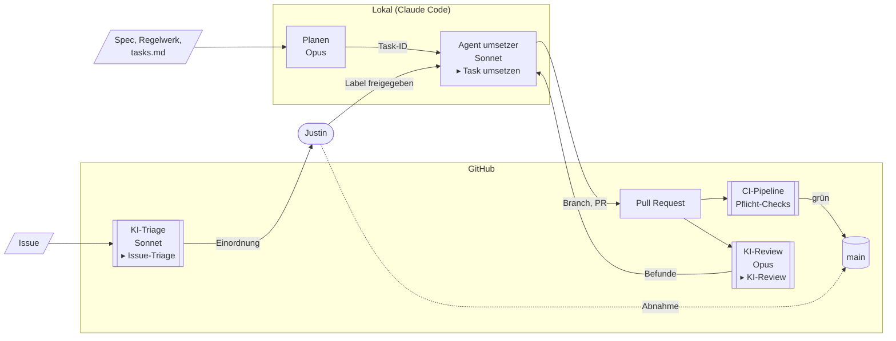
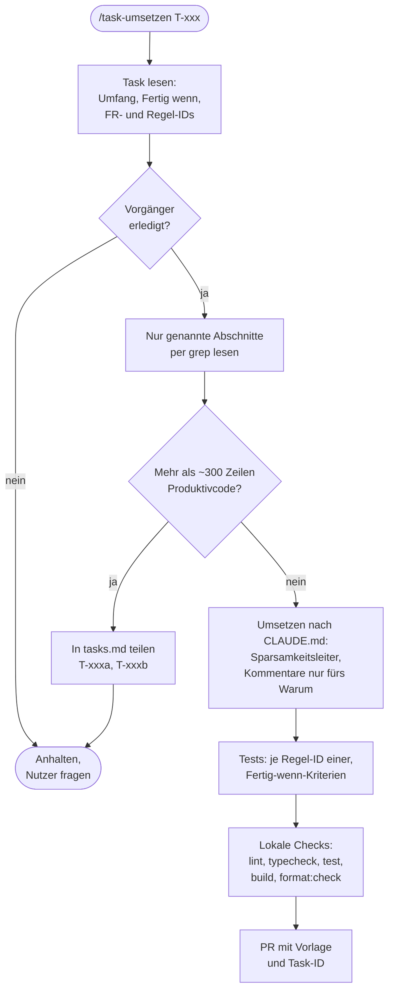
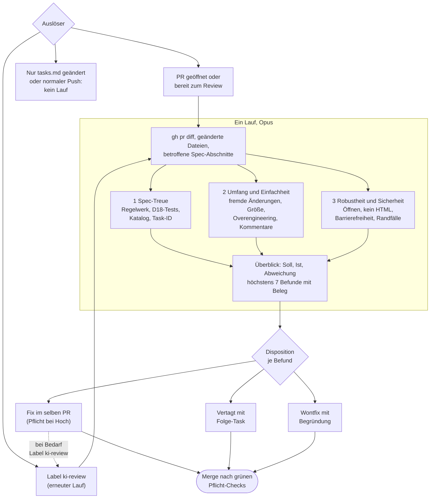
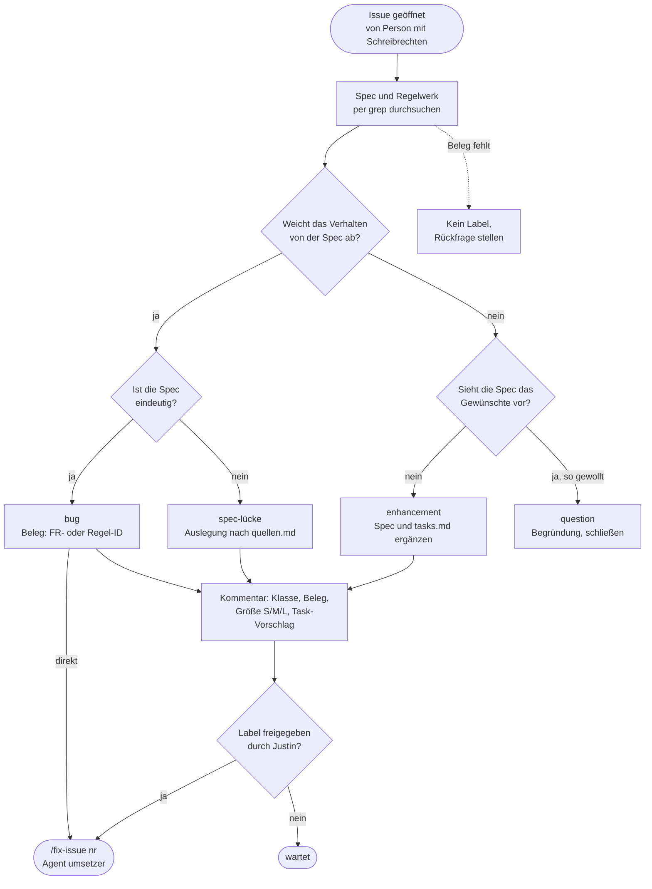

# KI-Workflow 001: TI Visualizer

**Stand:** 2026-11-10 · **Bezug:** [plan.md](./plan.md) (D29, „KI-Triage
und Agenten-Regeln“), [tasks.md](./tasks.md),
[`CLAUDE.md`](../../CLAUDE.md),
[`review-richtlinien.md`](../../.github/review-richtlinien.md)

Beschreibt, wie KI-Agenten in diesem Projekt planen, umsetzen, prüfen und
Issues einordnen. Die Diagramme sind in [Mermaid](https://mermaid.js.org/)
geschrieben, wie in [architektur.md](./architektur.md).

Inhalt: 1 Überblick · 2 Rollen und Modelle · 3 Task umsetzen · 4 KI-Review
· 5 Issue-Triage · 6 Wo die Regeln stehen · 7 Kosten begrenzen

## 1. Überblick

Die Spec ist der Maßstab für alles: Tasks kommen aus `tasks.md`, Issues
werden an Spec und Regelwerk gemessen, der Review prüft gegen beide. Der
Mensch (Justin) entscheidet an zwei Stellen: Freigabe neuer Features und
Merge bei offenen Hoch-Befunden bzw. bei Tasks mit Abnahme.

Bausteine mit „▸“ sind in einem eigenen Diagramm genauer dargestellt.

**Genauer dargestellt:** [umsetzer → 3 Task umsetzen](#3-task-umsetzen) ·
[KI-Review → 4 KI-Review](#4-ki-review) ·
[KI-Triage → 5 Issue-Triage](#5-issue-triage)

## 2. Rollen und Modelle

Teure Modelle nur dort, wo Denken den Unterschied macht. Routinearbeit
läuft auf Sonnet mit mittlerem Aufwand.

| Rolle | Wo | Modell | Aufwand | Definiert in |
|---|---|---|---|---|
| Planen, Tasks schneiden, Auslegung | lokal, Hauptsitzung | Opus | hoch | `~/.claude/settings.json` (`opusplan`) |
| Task oder Issue umsetzen | lokal, Agent `umsetzer` | Sonnet | mittel | `.claude/agents/umsetzer.md` |
| Bug mit unklarer Ursache | lokal, Hauptsitzung | Opus | hoch | von Hand wählen |
| KI-Review | GitHub Action | Opus | Standard | `.github/workflows/ki-review.yml` |
| Issue-Triage | GitHub Action | Sonnet | Standard | `.github/workflows/ki-triage.yml` |
| Gründlicher Review riskanter PRs | lokal, `/code-review high` | Opus | hoch | auf Zuruf |

## 3. Task umsetzen

Skill `task-umsetzen` (bzw. `fix-issue` für Issues), ausgeführt vom Agenten
`umsetzer`. Die Größenprüfung kommt **vor** dem Programmieren: Ein zu
großer Task wird in `tasks.md` geteilt, nicht im PR.

**Bugfix** (Skill `fix-issue`): zuerst ein Test, der den Fehler zeigt,
dann die Ursache in der gemeinsamen Funktion beheben, alle Aufrufer prüfen.

## 4. KI-Review

Ein Durchlauf, drei Blickwinkel. Kein Pflicht-Check: Über den Merge
entscheidet die Disposition jedes Befunds.

| Schwere | Bedeutung | Blockt Merge |
|---|---|---|
| Hoch | Verstoß gegen Spec oder Regelwerk, falsches Verhalten, fehlende Prüfung beim Öffnen | ja |
| Mittel | begrenzte fachliche Abweichung, Änderung außerhalb des Tasks, deutliches Overengineering | nein |
| Niedrig / Hinweis | kleine Unstimmigkeit, Vormerkung für Folge-Task | nein |

## 5. Issue-Triage

Neue Issues ordnet Sonnet nach dem Skill `triage` ein. Maßstab ist die
Spec, jede Einordnung braucht einen Beleg. Die Triage programmiert nicht.
Features und Spec-Lücken gehen erst nach dem Label `freigegeben` in die
Umsetzung, und das setzt nur ein Mensch.

| Größe | Produktivcode | Folge |
|---|---|---|
| S | unter 50 Zeilen | direkt ein PR |
| M | bis 300 Zeilen | ein PR |
| L | mehr | vor der Umsetzung teilen |

## 6. Wo die Regeln stehen

Jede Regel steht an genau einer Stelle. Lokale Agenten und die Workflows
im CI lesen dieselben Dateien, dadurch prüft der Review genau das, woran
sich der Umsetzer halten soll.

| Datei | Inhalt | Gelesen von |
|---|---|---|
| `CLAUDE.md` | Ablauf, Größe, Code, Kommentare, Tests | allen Agenten, lokal und im CI |
| `.claude/skills/task-umsetzen/` | Schritte für einen Task | `umsetzer` |
| `.claude/skills/fix-issue/` | Schritte für ein Issue | `umsetzer` |
| `.claude/skills/triage/` | Klassen, Kriterien, Ausgabe | KI-Triage, lokal `/triage` |
| `.claude/agents/umsetzer.md` | Modell, Aufwand, vorgeladene Skills | Hauptsitzung beim Delegieren |
| `.github/review-richtlinien.md` | Blickwinkel, Schweregrade, Disposition | KI-Review, Mensch beim Merge |
| `.github/workflows/ki-*.yml` | Auslöser, Modell, Rechte, Werkzeuge | GitHub Actions |

## 7. Kosten begrenzen

- **Review nicht bei jedem Push:** nur beim Öffnen, bei „bereit zum
  Review“ und auf das Label `ki-review`. Reines Abhaken in `tasks.md`
  löst keinen Lauf aus.
- **Ein Durchlauf statt mehrerer Review-Agenten:** Die drei Blickwinkel
  sind Abschnitte im selben Prompt.
- **Gezielt lesen:** Agenten suchen in den Specs per `grep` nach IDs statt
  die über 3.500 Zeilen ganz zu laden.
- **Grenzen je Lauf:** `--max-turns` (Review 50, Triage 20),
  `timeout-minutes`, keine Entwürfe, keine Fork-PRs.
- **Kleine PRs:** Die Größengrenze senkt neben der Komplexität auch die
  Tokens pro Review.
